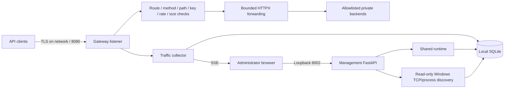

# Architecture

`app/main.py` creates the management application and enforces session, host,
origin, body-size and CSRF checks. `app/runtime.py` shares a database, HTTP client,
rate limiter and collector between management and a separate gateway listener.
The gateway runs inside the same process; it is not a second worker process.

`app/gateway/proxy.py` chooses an enabled route, validates policy, strips unsafe
forwarding/hop headers and administrator cookies, forwards a bounded request,
and records the decision. The original API handles business authentication and
data. Gateway client keys and optional upstream bearer credentials are separate.
The proxy supports bounded HTTP request/response forwarding; WebSocket upgrades,
unbounded streaming and arbitrary public upstreams are outside the current scope.

`app/database/db.py` maintains schema 3, serialized transactions, WAL, history
retention and consistent backups. Passwords use salted scrypt and browser session
identifiers are stored as SHA-256 hashes. The database is not encrypted at rest.
Persistent gateway quotas survive a process restart. In-memory SSE queues and
local listener state still require one application process.

`app/discovery/` enumerates TCP listeners and maps owning processes and Windows
services. It compares sockets with manually registered routes, then combines
current observations with health/forwarding evidence. An open TCP listener does
not prove an API is healthy or externally reachable. Verification explicitly
reports limits and never claims independently established external isolation.

The frontend uses local HTML/CSS/JavaScript and vendored Chart.js with no CDN or
Node build. Each installation starts with an empty inventory; existing records survive
upgrades. See [deployment](DEPLOYMENT.md) and [security policy](../SECURITY.md).
